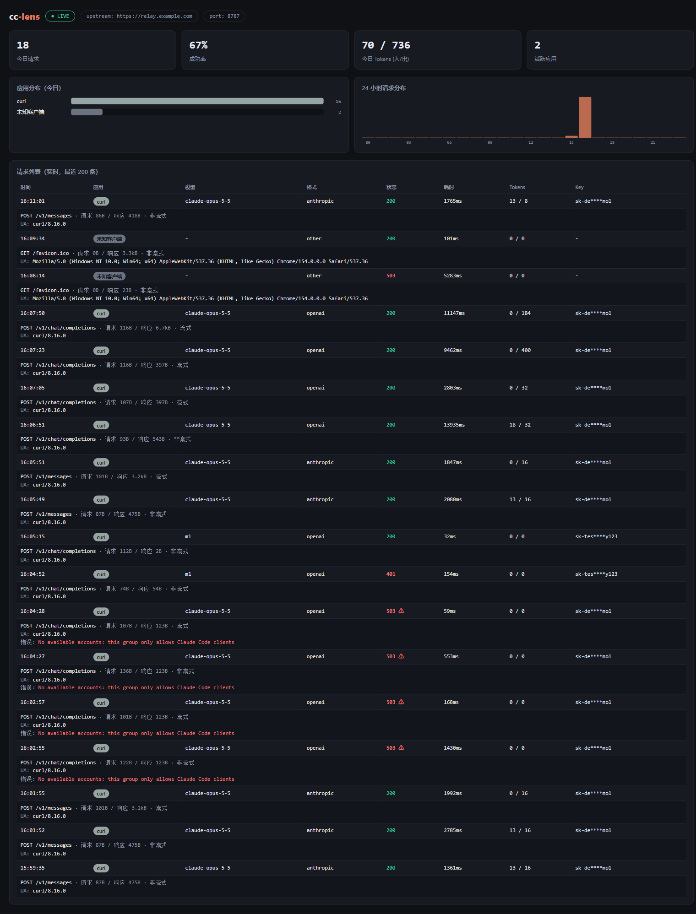

# cc-lens

> 给任意 Anthropic / OpenAI 兼容客户端加上 Claude Code 客户端指纹，转发到你的 AI 中转平台，并内置请求观测面板。**零依赖，单命令启动。**

[English](./README.en.md) | 简体中文

## 这是什么

不少 AI 中转平台（new-api / one-api 及其衍生）按请求特征识别客户端，**只放行来自 Claude Code 的请求**。想在 Qoder、Cline、Cherry Studio 等其他工具里使用自己在中转平台的额度，就会被拒之门外。

cc-lens 是一个跑在本地的轻量代理，它做两件事：

1. **指纹改写**：把你的请求补上 Claude Code 的 5 项客户端特征后转发给中转平台（特征来自对真实 Claude Code 流量的抓包分析）
2. **请求观测**：内置 Web 面板，实时展示哪些应用、在什么时间、用了什么模型、发了多少请求/token

支持的客户端格式：

- **Anthropic 原生**（`/v1/messages`）：Qoder、Cline、Roo Code、Continue、Claude Code 本身……
- **OpenAI 兼容**（`/v1/chat/completions`）：自动转换成 Anthropic 格式转发，响应（含流式 SSE）再转回 OpenAI 格式 —— Cherry Studio、Chatbox、Open WebUI、各种脚本 SDK 都能用

## 快速开始

要求：Node.js ≥ 18，无任何 npm 依赖。

```bash
git clone https://github.com/<你的用户名>/cc-lens.git
cd cc-lens
node cc-lens.js --upstream https://你的中转平台地址
```

启动后：

- 面板：`http://127.0.0.1:8787/`
- 客户端里把 API 地址改成 `http://127.0.0.1:8787`（OpenAI 兼容客户端填 `http://127.0.0.1:8787/v1`）
- API Key 填你在中转平台的令牌，cc-lens 原样透传

所有参数：

| 参数 | 环境变量 | 默认 | 说明 |
|------|---------|------|------|
| `--upstream` | `CCLENS_UPSTREAM` | （必填） | 中转平台地址 |
| `--port` | `CCLENS_PORT` | `8787` | 监听端口 |
| `--data-dir` | `CCLENS_DATA` | `./data` | 请求记录目录 |

## 面板



- 统计卡：今日请求、成功率、Token 用量、活跃应用数
- 应用分布（按客户端识别）、24 小时请求时间线
- 实时请求列表：时间、来源应用、模型、状态、耗时、Token 数、脱敏后的 Key；点开可见 UA 与错误详情
- 数据经 SSE 实时推送，同时落盘到 `data/requests.jsonl`（重启不丢）

## 客户端识别

cc-lens 通过 User-Agent 识别请求来自哪个应用：Claude Code、Qoder、Cursor、Windsurf、Cherry Studio、Chatbox、Cline、Roo Code、Continue、VS Code、curl、Python/Go/Java SDK 等。识别不了的会显示原始 UA。

自定义规则：在数据目录建 `data/apps.json`（重启生效）：

```json
[
  { "name": "我的脚本", "ua": ["my-tool/"] }
]
```

## 它注入了什么

对每个发往中转平台的 `/v1/messages` 请求，cc-lens 补上这 5 项特征（均来自真实 Claude Code 客户端）：

| # | 位置 | 内容 |
|---|------|------|
| 1 | 请求头 `User-Agent` | `claude-cli/x.x.x (external, cli)` |
| 2 | 请求头 `x-app` | `cli` |
| 3 | 请求头 `anthropic-beta` | 补充 `claude-code-20250219` |
| 4 | 请求体 `system[0]` | `x-anthropic-billing-header: ...` 计费标识块 |
| 5 | 请求体 `metadata.user_id` | 含 device_id / session_id 的 JSON 字符串 |

中转平台升级检测方式后，通常只需更新 `lib/fingerprint.js` 顶部的几个常量。

## 隐私与安全

- cc-lens 完全本地运行，请求内容不经过任何第三方
- 记录与面板中的 API Key 已脱敏（只留前 6 后 4 位），请求体内容不落盘
- 请勿将面板端口暴露到公网

## 免责声明

本项目仅供个人在已付费/已授权的中转平台上自用与学习。使用前请了解并遵守你所在平台的服务条款；因违反平台规则导致的账号限制等后果由使用者自行承担。

## License

[MIT](./LICENSE)
